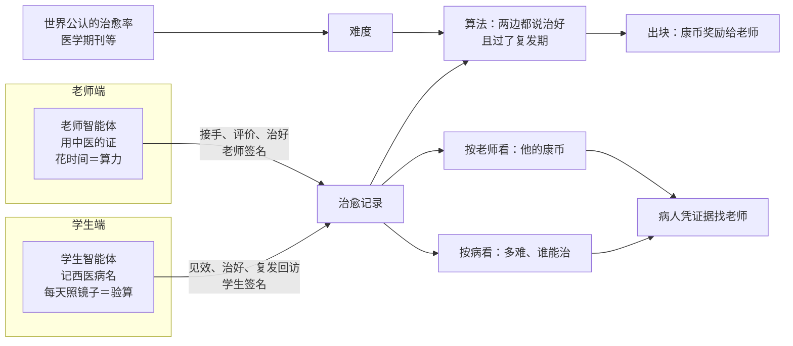

# 康币定义

- 来源：发起人与技术合伙人 2026-10-23 的讨论
- 性质：定义框架。标“已定”的是发起人认可的；标“待验证”的今天不下结论，等社区运行、有了数据再定
- 不改动：医纲第四条、康币规则文件、代码。动手大约在一两年后，届时按本文改医纲

---

## 一、康币要解决的问题

好老师不缺钱，也愿意把方法传出去，难的是**别人不信**。有本事的人没有一个不靠权威的办法证明自己有本事；病人只能靠听说，“某某老师能治这个病”，跑过去才发现不行，钱花了，时间耽误了。

比特币回答的是：没有银行担保，怎样让陌生人相信一笔钱是真的——工作量证明，规则公开，人人可以自己验算。

康币回答的是：没有医院、文凭、官方背书，怎样让陌生人相信这位老师真能治这个病——**治愈证明**：一例一例真实治好的病，按公开的规则记下来，谁都看得到。

康币要的是靠定义被认可，不靠哪个“主子”认可。

## 二、定义（已定）

1. **康币是奖励，不是目标。** 老师平时尽力把每一位病人看好，康币作为奖励自然就来了。真正有大愿的好老师不为康币而治病，就像中本聪不为做世界首富。
2. **康币是对老师治病能力的衡量，也是计账单位。** 它既是“币”也是“衡”，就像比特币既是记账体系也是货币单位。老师以自己的康币定价；怎样兑现、怎样兑换，是第二个问题（见第九节）。
3. **康币建立的是信用。** 让病人凭证据、而不是凭听说，尽快找到真能帮他的老师。
4. **只评疑难病。** 世界公认难治的病（西医治愈率很低的那一类）才算；感冒这类不算。
5. **病名用西医的。** 要世界公认，就用世界通用的病名。中医里只有会治与不会治，没有治不了的病（《黄帝内经》：病都是违背自然规律而来，改了就能好，只看时间够不够）。
6. **结果只有两种：治愈、不治。** 没有“好转”。不治是指没治好或短期内复发。没治好的也要算进治愈率。
7. **“这个病我不治”是好事。** 那是不在自己做不了的事上花算力，不奖也不罚。
8. **难度在病和方法之间。** 难者不会，会者不难：同一个病，在一种方法手里要一年还会复发，在另一种方法手里一个月就好。难度表现为时间。
9. **方法跟人绑定。** 同源的方法到不同老师手里各有调整；同一种病，谁的治愈率最高，就认谁的方法最好。
10. **出块由算法决定。** 矿工说了不算。
11. **学生增长属于算力，不在定义里。**
12. **治未病是学生的目标，康币衡量的是老师的能力。** 学生进社区是为了治好病、学会怎样生活，不是为了得到康币。想要康币，就去当老师。

## 三、和比特币对照

| 比特币 | 康币 |
|---|---|
| 矿工 | 老师 |
| 算力（花掉的电） | 花在病人身上的时间；学生的增长 |
| 无效的哈希 | 没治好的那部分时间 |
| 找到有效区块 | 治好一例：老师、学生都确认，并过了复发期 |
| 难度 | 这类病的难度 |
| 不去挖 | “这个病我不治” |
| 区块奖励 | 康币 |
| 全节点验算 | 学生智能体每天照镜子 |

不同之处：比特币里挖不到块，浪费的是矿工自己的电；康币里没治好，成本由**双方分担**——学生选错了人、耽误了时间，老师白花了时间、名声也受损。康币不替谁赔这份成本，而是让它变少：病人凭证据挑人，就不必一个一个去试。

## 四、一本账，两种看法

账上每一条是一例病的记录。同一本账：

- **按病看**：这类病有多少人接手、治好几例、平均多久——由此看出它有多难，以及谁能治。
- **按老师看**：他在每类病上治好多少、各花多久——合起来就是他的康币。

病人找老师，**不是看总康币，是看这类病上谁的多**。总康币多的老师，可能全是治同一类病挖来的。

两种看法之间的回环（待验证）：病越难，治好一例奖励越多；能治好它的人越多，它就越不难，后来者每例得到的就少一些——相当于比特币的难度调整。第一个攻破难题的人得到最多。

## 五、两个智能体的分工（已定）

- **学生智能体记着西医病名**（例如“抑郁症”），因为那是学生自己的诊断，也是记分用的世界语言。
- **老师智能体不管病名**，用中医自己的语言（例如“肝郁”“心脾两虚”）来治。
- **照镜子就是验算。** 学生每天照镜子、打卡，都在学生手机上按时间留下，老师碰不到；会不会复发，学生智能体天天在算。手机上的细节不外传，只把“还好着 / 又犯了”这样的结论由学生本人确认后发出。

## 六、一条治愈记录里装什么（算法吃进去的“事实”）

1. 西医病名，以及确诊的来源
2. 老师（方法跟人绑定）
3. 开始的时间
4. 第一次明显见效的时间（学生说）
5. 治好的时间
6. 老师的评价、学生的评价
7. 复发期内学生智能体的回访结论

难度的基准：医学期刊等世界公认的治愈率，加上社区自己的实测。

## 七、出块原则（公式由技术合伙人负责）

- 老师和学生两边都说治好了，并且过了这类病的复发期，才出块。
- 复发期内，任何一边报告复发，这一例就不算。
- 老师说“我不治”，不花算力，不奖不罚。

## 八、一个真实的例子：小黄老师

- 治脊椎侧弯。他认为很多病都源自脊椎的问题。
- 学生到他那里七天，**七天之内一定明显见效**；之后回家自己练，他远程辅导。彻底好要半年还是三年，看学生自己练得怎样。
- 七天统一收费一两万到三万。相比别处治一个抑郁症动辄十几二十万，其实不贵；来的多是各家医院治不好的。
- 来的学生多是小学生、初中生，所以治愈率很高。

这个例子说明了几件事（都待验证）：

- **见效时间是老师本事最直接的信号。** 小黄老师是七天，发起人的经验是三天：真会治的人，整个病就算要半年，几天之内也一定让人明显感到效果。它不做成规矩，只作为一条事实记下来、给人看。
- **“多久治好”里有一半是学生自己的功夫。** 衡量老师时，要结合学生练得怎样（作业坚持记录）再算。
- **病人是谁会影响治愈率**，例如年纪。
- **“医院诊断过、治过、没治好”本身就是硬的难度凭据。**

## 九、不在定义里的（第二个问题）

- 兑现与兑换：老师手里有康币、以康币定价；学生怎样拿到康币（不是老师卖给学生，具体途径未定）。
- 一个康币值多少法币、由谁定。
- 钱账和康币账：现在照医纲分开，不互相兑换；动手时再定。

**康币总会流通，只是时机问题（发起人判断）。** 三个趋势正在重叠：

1. 比特币这类虚拟货币，会被越来越多的人熟知；
2. 健康会成为越来越多人重视的东西，而不只是钱；
3. 社区里的人会越来越年轻，而不是越来越老。

社区不是一个封闭、独立的空间，它的人和现实世界是重叠的。所以康币迟早会流通，要等的只是时机。

## 九之二、发起人补记（2026-10-23 夜）

1. **康币是向中本聪致敬的作品。** 它颠覆“健康长寿可以用钱买到”的观念，锚定的是**时间**。花巨资换器官、买健康少男少女的骨髓和干细胞，这些都是不人道的，甚至是罪恶的。
2. **学生花时间遵医嘱、学中医知识、改掉不良生活习惯，本身就该视为挖矿，值得鼓励。**（与第二节第 11、12 条“学生增长属算力”“想要康币就去当老师”如何统一，待讨论）
3. **康币只在健康领域流通。** 与其他垂直领域的虚拟货币、与法币兑换，都以**比特币为媒介**，不直接兑换。
4. **康币的流通可以只在智能体之间（虚拟世界）发生**，不直接呈现在真实的人与人之间和现实世界。

## 十、待验证的问题

1. 难度怎样随“能治好的人多少”自动调整；方法传开后，原创者的单例回报下降，要不要在后人每次用他的方法治好时分给他一点（师恩）。
2. 每类病的复发期多长、由谁定；确认之后又复发，撤不撤。
3. 镜子（旁证）和学生的话（主证）对不上时，这一例怎么办。
4. 学生的评价不诚实：恶意报复发，或和老师串通说治好。
5. 学生勤奋与老师水平怎样分开；病人年纪等变量怎样计入。
6. 账本要不要像比特币那样公开、让外人自己验算：只有病名、时间、结果和老师的钥匙，没有学生是谁；这与“数据跟人走”怎样共存。
7. 账本上是否永远不出现中医的证和方法：成绩公开，方法留在老师手里、只靠师承传——这样康币证明你会，又不泄露你怎么会。
8. 学生三年勤练治好了病，功劳都记在老师身上；学生这边除了病好，要不要也留下点什么。
9. 将来流通时，“累计挖到多少”（名声，只增不减，除非复发被撤）和“手里现在有多少”（余额，随流通进出）要分开记，免得有人用钱买到名声。

## 十一、与社区愿景的呼应

康币不是社区之外另加的一套东西，而是《社区起源》里那个愿景的另一种体现。

**知衡的“衡”。** 衡本是秤杆。康币既是币，也是衡：它是这杆秤称出来的读数——称的不是货，是一位老师治病的本事。

**今天的蔡桓公为什么不信扁鹊。** 桓公说“寡人无疾”，扁鹊说了四次，他一次也没信。今天的病人也一样：好医生就在身边，他不信，或者信了听说、找错了人。康币要做的，就是让本事拿证据说话，让病人凭证据、不凭听说，找到真能帮他的人。

**天地为师。** 《内经》说病都是违背天地的规律而来的。所以中医没有治不了的病，只有会不会治、时间够不够。康币因此不分“能治的病”和“不能治的病”，只量“多久、谁会”。

**最好的医生，名不出于家。** 康币奖励的是扁鹊——把已经成了的病治好。可社区真正的成功，是让扁鹊越来越没有用武之地：治未病做得越好，疑难病越少，能挖的块越少。比特币的减半写在规则里；康币的“减半”，要靠治未病自己做出来。康币越来越少的那一天，就是扁鹊大哥的胜利。

**不是医院，是修行院。** 健康买不来，不是病人给了钱，医生就得把病治好。所以康币是奖励，不是买卖；治不好的成本，师生双方分担。“多久治好”里有一半是学生自己的功夫——小黄老师的学生回家后练半年还是三年，看自己。每个人都是自己健康的第一责任人。

**隐于民间。** 治未病的社区没有总部，扁鹊不入宫。康币也没有中心：出块靠算法，认可靠定义，不靠任何“主子”。好老师被看见了，也不被同化——成绩可以公开，方法留在老师手里，只通过师承一代一代传下去。

**两个知衡。** 学生智能体每天照镜子，就是在替学生验算：会不会复发，天天都在算。现实里的那个知衡自己就是学生，他照的那面镜子，也是这本账的一部分。

**Aster：天下一家。** 病名用西医的，是因为它是全世界都听得懂的语言：人没有东西之分，病也不该只在一种语言里被认可。天上的玉衡，和阿斯特赖亚手里的天平，是同一杆秤；康币想做的，是让这杆秤在医疗界立起来。

## 十二、远景

发起人希望：以后没有人需要靠医生。生活习惯是常年累月造成疾病的，健康的意识、中医的道理越早注入越好；小时候就懂了这个道理，长大了就不得这个病。到那时，康币还在，只是很少有人再需要它。

## 结构图

