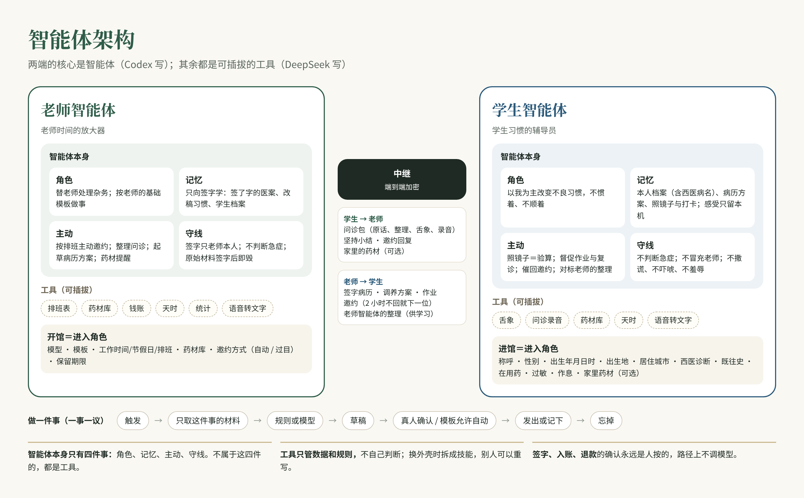

# 智能体架构

- 依据：医纲；`docs/product/two-agents.md`；决策 2026-10-23（预约以老师智能体主动邀约为主；两端的核心是智能体；学生智能体以我为主改变习惯；原始材料用完即毁；一事一议、只向签字学）
- 谁来写：**智能体本身**由 Codex 写，或技术合伙人写、Codex 审；**工具**由 DeepSeek 写

## 一、一句话

两端的核心是智能体：老师智能体是老师时间的放大器，学生智能体是学生习惯的辅导员。其余的都是工具，可以插拔，可以换人重写。

## 二、蓝图



## 三、智能体本身：四件事

每个智能体只由这四件事构成。不属于这四件的，都是工具。

| | 老师智能体 | 学生智能体 |
|---|---|---|
| **角色** | 替老师处理杂务，让老师把时间花在辨证施治上。按老师的基础模板做事 | 学生的辅导员。治未病是习惯养成，以我为主，不惯着、不顺着 |
| **记忆** | 老师签了字的医案（只向签字学，改过的分量最重）；老师的模板和改稿习惯；名下学生的档案和坚持情况 | 学生本人的档案（含西医病名）；老师签发的病历和方案；每天照镜子和打卡的记录；本人感受只留本机 |
| **主动** | 每天：按排班找空闲时段、主动邀约有一段时间没来的学生；整理问诊（听一遍录音之外的事都替老师做）；起草病历和方案；药材快用完时提醒 | 每天：照镜子（也是在验算会不会复发）；督促作业；该复诊了就催；老师发来邀约，催学生回复；问诊时整理学生的话，对标老师智能体的整理来学 |
| **守线** | 签字只能老师本人；不判断急症和心理状况；原始材料签字后即毁；不替老师答应他没答应的事 | 不判断急症和心理状况；不冒充老师给诊断；不撒谎、不吓唬、不羞辱；感受细节不外传 |

## 四、智能体做一件事的方式（一事一议）

```
触发（到点 / 收到消息 / 人点了一下）
  → 取材料（只取这件事要的，受额度上限约束）
  → 规则或模型（能用规则的不调模型）
  → 草稿
  → 真人确认（或基础模板允许自动）
  → 发出 / 记下
  → 忘掉（下一件事不带这一件的对话）
```

签字、入账、退款这类事，确认那一步永远是人按的，路径上不调模型。

## 五、进入角色

**开馆 = 老师智能体进入角色。** 下面这些做完，才能邀请第一位学生：

1. 接入模型
2. 问诊模板、病历模板（有默认，老师可改）
3. 工作时间、节假日、排班
4. 药材库（自己采购、煲药的老师要用；不用的可标“不备药”）
5. 邀约方式：**自动邀约**，或**老师过目后再发**
6. 旧病历保留期限

**进馆 = 学生智能体进入角色。** 下面这些填完，才能第一次问诊：

1. 称呼、性别、出生年月日和时辰、出生地、居住城市
2. 西医诊断（有就填）、既往病史、在用药、过敏
3. 平时的作息
4. 家里的药材（可选）

每一项都有输入校验（日期不能在未来、年龄要合理、家人之间的年龄关系要讲得通等），写在各自的任务卡里。

## 六、预约：老师智能体主动请人来

- 老师智能体每天对着排班表，找出空闲时段，挑出有一段时间没来的学生，给每人发一个具体时段。
- 学生 **2 小时**没回复，就发给下一位；也可以同时发给几位。约了不到常有，宁愿多几位同时到，老师应付得来——这是用时间换健康，学生不会吃亏。
- 邀约方式按开馆时选的：自动发，或老师过目后再发。
- 学生也可以自己约，但不是主路。

## 七、学生智能体的督促

治未病是习惯养成，懒惰也是一种病。学生智能体以我为主，主动去改学生的不良习惯，不惯着、不顺着；不担心学生因此卸载。

它可以：天天提醒、越拖越紧地催、把坚持情况如实摆给学生看、在老师邀约时催他回复。

它不可以：撒谎、吓唬、羞辱，或者冒充老师下诊断。

## 八、工具（可插拔）

工具只管数据和规则，不自己做判断；由智能体在需要时调用。以后产品换成小程序、App 或别的外壳，工具就拆成技能，别人可以用自己的代码重写。

| 工具 | 谁用 | 说明 |
|---|---|---|
| 排班表 | 老师 | 工作日、工作时间、节假日、已约时段 |
| 药材库 | 老师、学生 | 药名、数量、单位、警戒线；当面开方扣库存，不能扣成负数 |
| 问诊录音 | 学生 → 老师 | 加密发给老师，老师听一次，签字后即删 |
| 语音转文字 | 两端 | 以后接；现在用手机键盘的话筒 |
| 舌象 | 学生 | 拍照、裁剪、抽特征，原图当场清掉 |
| 天时 | 两端 | 时辰、节气、当地天气 |
| 钱账 | 老师 | 说一句话起草，老师确认入账 |
| 统计 | 老师 | 社区仪表盘的数值小结 |

## 九、两个智能体之间传什么（经中继，端到端加密）

- 学生 → 老师：问诊包（原话、整理、舌象裁剪图、录音）、坚持小结、邀约回复、家里的药材（学生选择附上时）
- 老师 → 学生：签字病历、调养方案、作业、邀约、老师智能体对这次问诊的整理（学生智能体据此学）

## 十、和现有代码的对应

已经有的，归到上面的四件事和工具里：`drafting/`、`intake/`、`mirror/`、`homework/`、`adherence/`、`careplan/` 属于智能体本身；`abstractor/`、`tongue/`、`heaven/`、`ledger/`、`dashboard/` 属于工具。

还没有的：两个智能体的“角色”和“主动”还散在各页面里，没有一个明确的智能体模块；开馆与进馆的基础工作、排班、预约邀约、药材库、问诊录音、学生智能体的督促都要新做。具体拆成哪几张卡，等旧仓库 zhiheng-tcm 的盘点交来再定。
