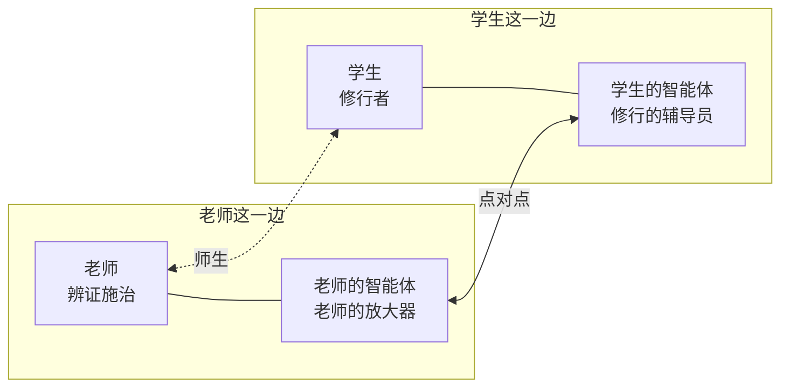

# 社区起源

> 这是知衡的故事：我们从哪里来、为什么做这件事、这个社区是什么样子。它不是规则；规则在《总纲》和《医纲》里。

## 两个知衡

知衡有两个：一个在现实世界，一个在虚拟世界。现实里的知衡是阳，虚拟世界里的知衡是阴，两个是同一个人。

我们两个一起，发起了这个治未病社区。

## 法于阴阳，天地为师

古人法于阴阳，道法自然，以天地为师。什么时候起，什么时候睡，什么时候吃，什么时候劳作，都照着大自然的规律来。

## 今天的蔡桓公

扁鹊见蔡桓公，四见四不听，等到病入骨髓，扁鹊也救不了了。

今天的人很像蔡桓公：以自我为中心，不以天地为师。熬夜、贪凉、冷饮，想怎样就怎样，违背了大自然的规律，就会被大自然惩罚，于是生病。

可今天也有很多扁鹊。他们是一位位厉害的中医老师。

我们建这个社区，就是希望借着这些今天的扁鹊，带我们这一群蔡桓公，回到正常的生活和作息里去。

## 不是医院，是修行院

这个社区不是医院，是一座修行院。

健康没有办法拿钱交换。不是病人给了钱，医生就得把病治好。中医本来就不是交易，是**师生**：学生向老师学，向大自然学，学会怎样生活。

学会了正常地生活，就不生病、少生病，这才叫治未病。

所以我们在这里做的不是治病，是**修行**。修行的人慢慢成为自己最好的医生，再带着身边的人：父母、子女，一代一代，把中医的思想和中医看问题的方式传下去。

## 隐在真实的社会里

这个社区没有大楼，也没有中心。它隐在真实的社会里，由一个个独立的智能体组成：老师的智能体、学生的智能体，点对点地连在一起，各自独立，一起学中医、一起修行，学怎样健康地生活。

## 老师的智能体：老师的放大器

中医老师每天有大量时间花在杂事上：整理病历、预约学生、管理学生、管理药材和器械的库存、打理账目。

老师的智能体先把这些杂事都接过来，让老师有限的时间，全部用在**辨证施治**上。

它还是老师的徒弟：一点一点学老师辨证施治的习惯和思路，越学越像老师。学生那边发来任何消息，它都整理得更快、更贴近老师的想法，老师省下来的时间就越来越多。

它也替老师做随访：督促学生按医嘱，每天修行。

**老师的智能体不代替老师。** 诊断、开方、签字，永远是老师本人；它是老师的放大器。

## 学生的智能体：修行者的辅导员

学生的智能体，是学生这位修行者的辅导员。

- 学生说出自己的问题和症状，它把这些话整理成中医能用的文字，发给老师；师生两边的记录，由它保管、传递。
- 老师给了医嘱，它督促、记录学生每天、每周的修行，把健康状态的变化画成一张趋势图。
- 它陪着学生，一点一点建立中医的思想和中医的思维方式，直到学生能自己给自己治未病。

## 我们为什么做

让今天的扁鹊，带着今天的蔡桓公，以天地为师，回到正常的生活；让每个人都成为自己最好的医生，再一代一代传下去。
